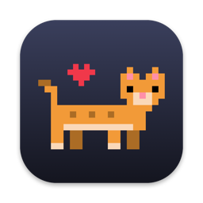
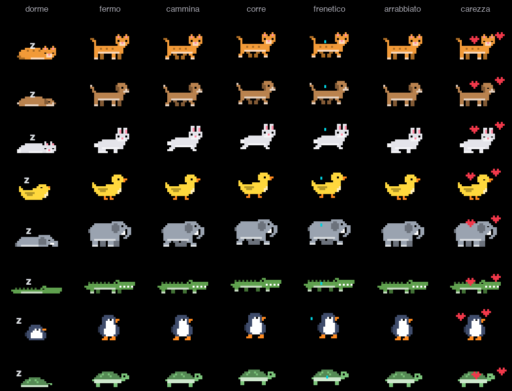
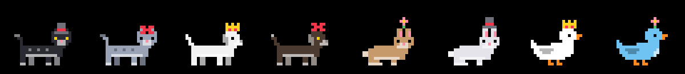
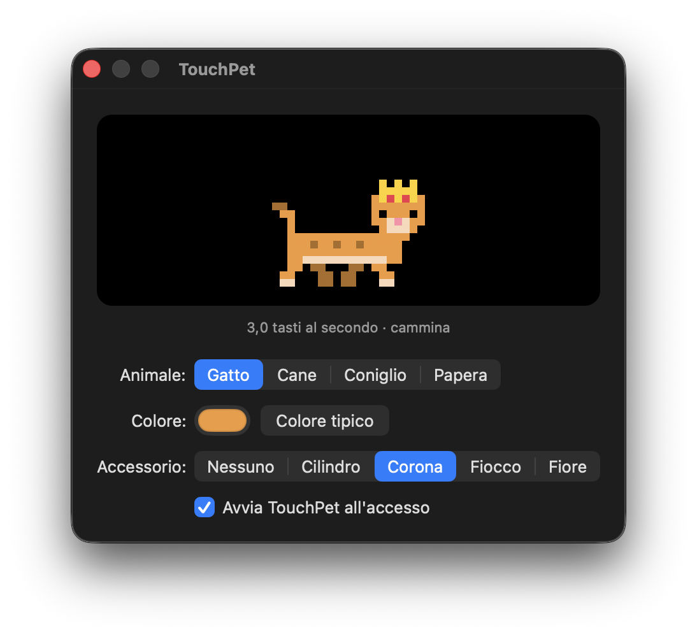

<p align="center"></p>

# TouchPet

Un animaletto che vive nella **Touch Bar** del MacBook Pro e reagisce a come scrivi: cammina se digiti piano, corre se digiti veloce, dorme se ti fermi e si arrabbia se premi troppo Backspace. Resta visibile con qualsiasi app in primo piano. La grafica è pixel art disegnata interamente dal codice: nessun file di immagine.


**[⬇️ Scarica l'ultima versione](https://github.com/AlbyToniolo-byte/touchpet/releases/latest)**

## Come si usa

L'animale sta nella **Control Strip**, a destra della Touch Bar, accanto a luminosità e volume. Non ha finestra né icona nel Dock.


| Azione | Come |
|---|---|
| Dargli spazio per correre | tocca l'animale: la barra si espande |
| Accarezzarlo | toccalo nella barra espansa |
| Personalizzarlo | tasto **Personalizza** nella barra espansa, oppure apri di nuovo l'app |
| Richiudere la barra | la ✕ a sinistra |
| Chiudere l'app | tasto **Esci** nella barra espansa |

## Umori

L'umore dipende da quanti tasti premi al secondo, in media sugli ultimi secondi.



| Umore | Quando |
|---|---|
| 💤 Dorme | nessun tasto da 30 secondi |
| 🐾 Fermo | non stai scrivendo: scodinzola e sbatte gli occhi |
| 🚶 Cammina | meno di 4 tasti al secondo |
| 🏃 Corre | da 4 a 8 tasti al secondo |
| 💦 Frenetico | più di 8 tasti al secondo (circa 95 parole al minuto) |
| 💢 Arrabbiato | circa 5 Backspace di fila, o Backspace tenuto premuto 2 secondi |
| ❤️ Accarezzato | l'hai toccato |

## Personalizzazione

Quattro animali (gatto, cane, coniglio, papera), il colore del pelo che vuoi e quattro accessori: cilindro, corona, fiocco, fiore. Le scelte restano salvate.



La finestra mostra un'anteprima (un clic la accarezza) e, sotto, i tasti al secondo e l'umore del momento. Da qui si attiva anche l'avvio automatico all'accesso.

<p align="center"></p>

## Privacy

TouchPet **non legge cosa scrivi** e non chiede nessun permesso (né Accessibilità né Monitoraggio input):

- la velocità viene da un contatore di macOS che dice solo *quanti* tasti sono stati premuti, non quali;
- per Backspace chiede a macOS soltanto "questo tasto è premuto adesso?", 30 volte al secondo.

Niente viene salvato o inviato, a parte le tue scelte di aspetto nelle preferenze dell'app.

## Installazione

Serve un **MacBook Pro con Touch Bar** e **macOS 13** o successivo (Apple Silicon o Intel).

1. Scarica `TouchPet.zip` dall'[ultima release](https://github.com/AlbyToniolo-byte/touchpet/releases/latest), estrai e sposta **TouchPet** in Applicazioni.
2. L'app non è firmata con un certificato Apple, quindi al primo avvio macOS la blocca: apri **Impostazioni di Sistema → Privacy e sicurezza** e premi **Apri comunque**. In alternativa, dal Terminale:
   ```bash
   xattr -dr com.apple.quarantine /Applications/TouchPet.app
   ```
3. Aprila: l'animale compare nella Control Strip. Se non lo vedi, controlla che in **Impostazioni di Sistema → Tastiera → Impostazioni Touch Bar** la Touch Bar mostri i controlli delle app con la Control Strip.

## Compilare dal codice

Bastano gli strumenti da riga di comando di Xcode (`xcode-select --install`).

```bash
./build.sh           # esegue i test, crea TouchPet.app (universale) con l'icona
./build.sh install   # come sopra, poi la copia in Applicazioni e la avvia
```

Tutto il programma è in [`main.swift`](main.swift). Opzioni utili per provarlo senza scrivere:

```bash
TouchPet.app/Contents/MacOS/TouchPet -rate 6 -expand YES   # forza 6 tasti al secondo e parte già espanso
TouchPet.app/Contents/MacOS/TouchPet -rate -1              # lo fa dormire
TouchPet.app/Contents/MacOS/TouchPet --sheet animali.png   # tutti gli animali in tutti gli umori, in un'immagine
```

## Come funziona

- **Sempre visibile**: la Touch Bar normale mostra solo i controlli dell'app in primo piano. Per restare nella Control Strip TouchPet usa alcune funzioni private di macOS (dichiarate in [`private.h`](private.h)), lo stesso metodo di app come Pock e MTMR. Per questo non può stare sull'App Store, e un futuro aggiornamento di macOS potrebbe romperle.
- **Umore**: una funzione pura, `mood(rate:idle:anger:)`, separata dal disegno e controllata da test a ogni compilazione. La velocità passa per una media mobile, così l'animale accelera e rallenta con dolcezza.
- **Disegni**: ogni animale è una griglia di caratteri (testa, corpo, tre posizioni delle zampe, posa da addormentato). Tutti i colori derivano da quello del pelo, quindi ogni animale funziona in qualsiasi colore. Per aggiungerne uno basta una voce in `speciesList`.
- **Consumo**: da fermo o addormentato ridisegna 5 volte al secondo invece di 30; in tutto usa circa l'1% di CPU.
